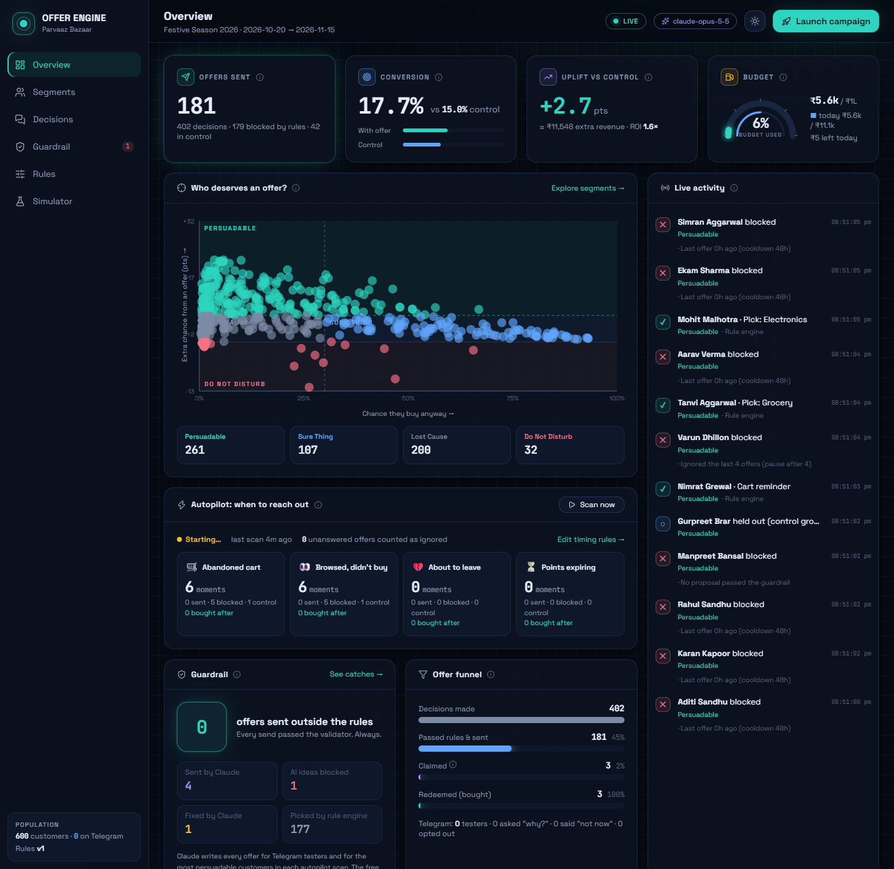
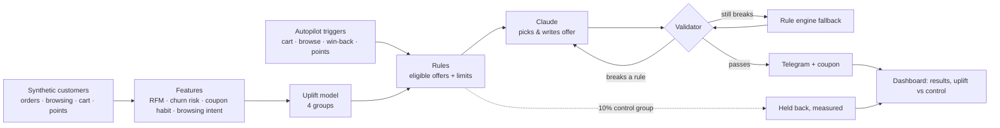
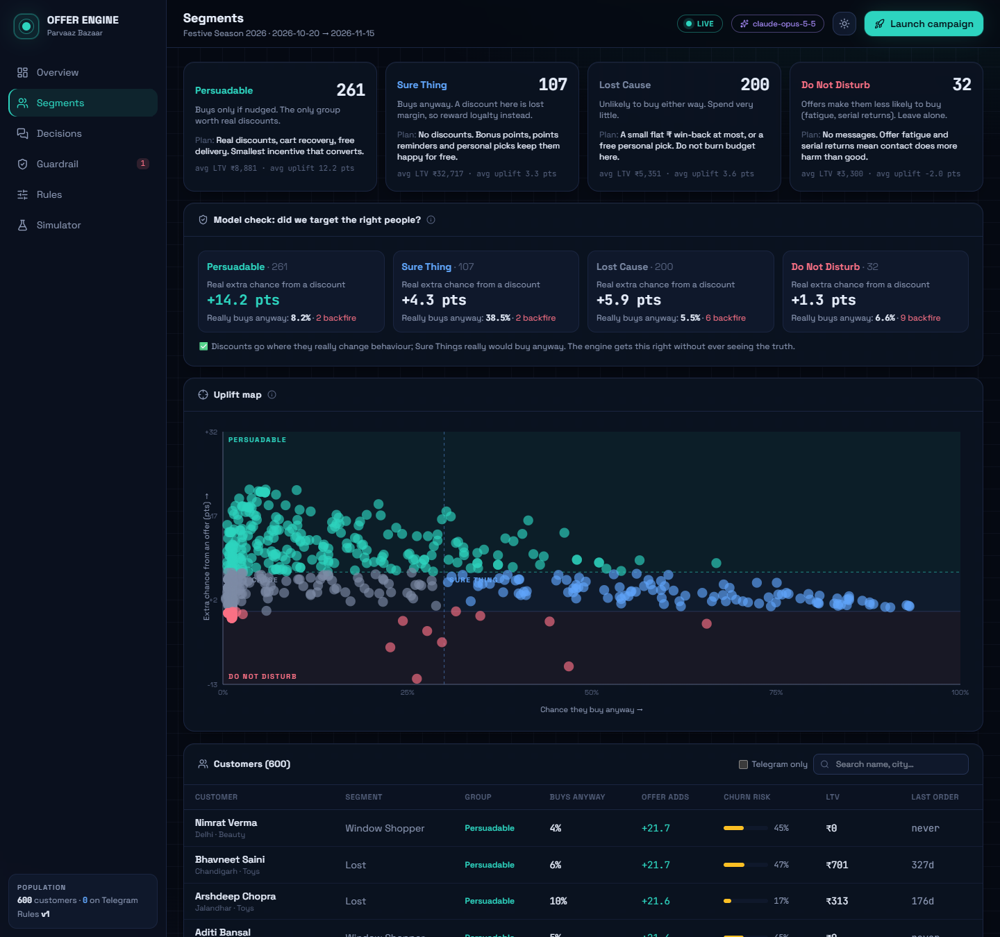
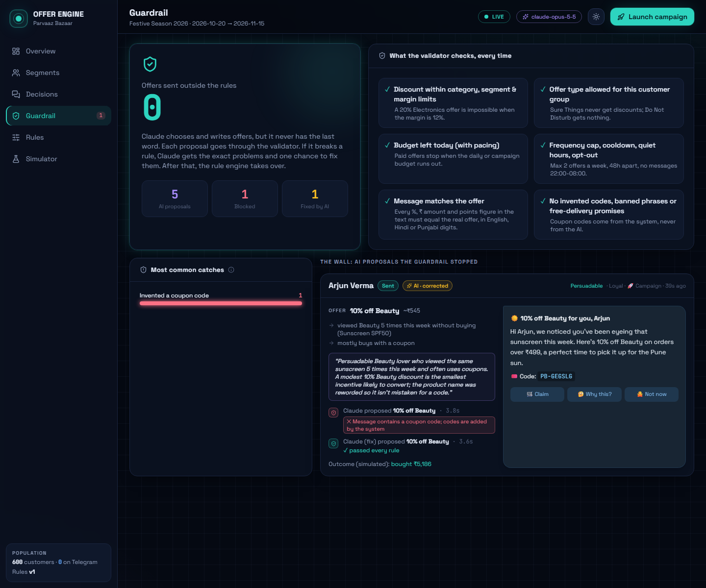
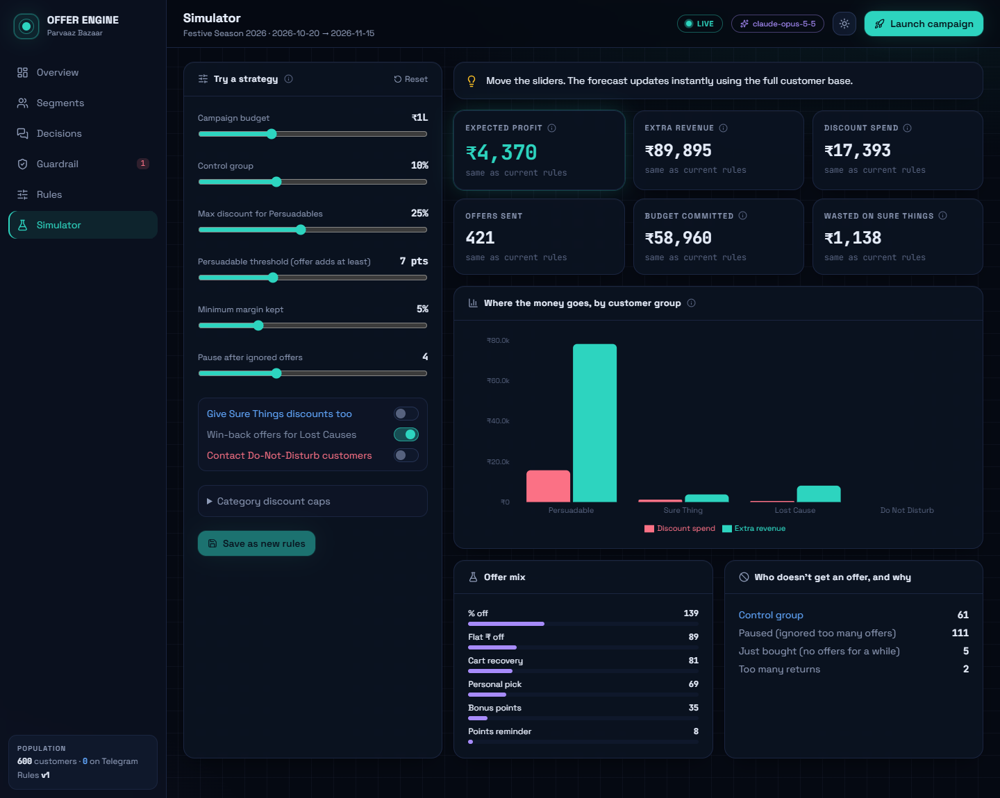
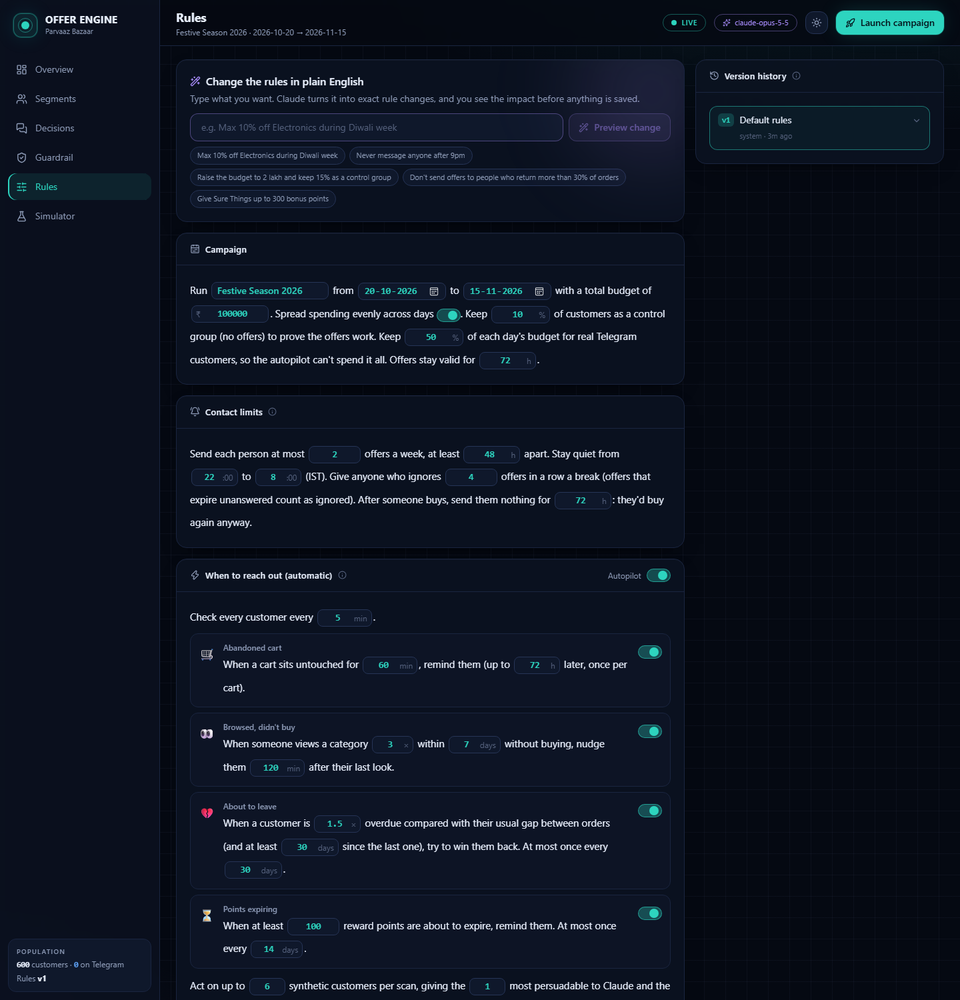
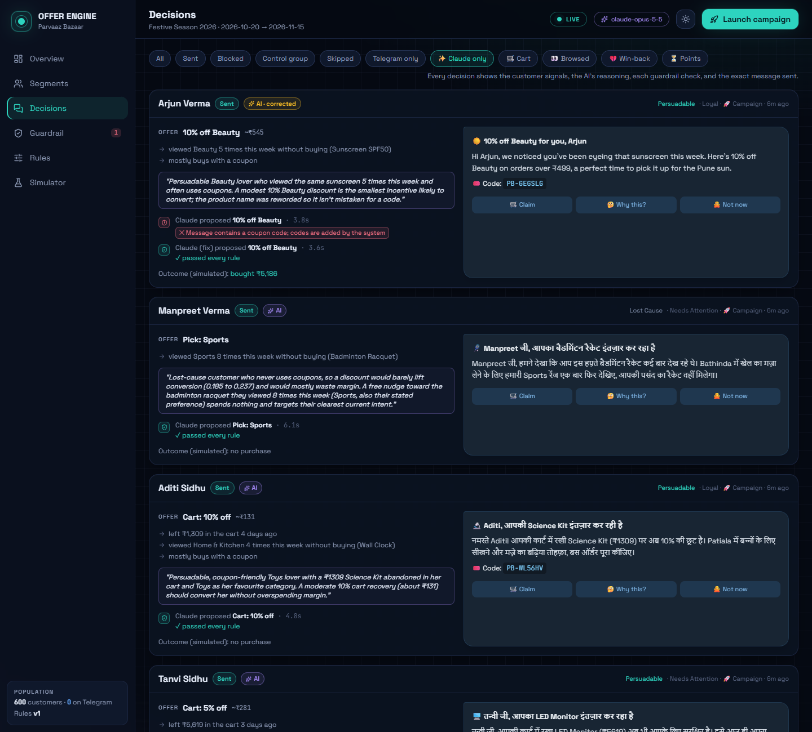

# Personalised Offer Engine

**Decides which offer each customer should get, and when. Claude personalises it; every offer is checked against the business rules before a customer ever sees it; offers reach real people on Telegram.**

Hackathon 2 · Punjab Jobs AI Bootcamp × J-PAL South Asia · Individual project by Bhavneet Kour

| | |
|---|---|
| 🤖 **Telegram bot** | [@EcomBhavneet_bot](https://t.me/EcomBhavneet_bot) (press **Start**) |
| 📊 **Marketing dashboard** | https://offer-engine-acg7.onrender.com (password-protected; ask me for the password) |
| ✅ **Tests** | 52 automated tests, `npm test` |
| 🛍️ **Data** | 100% synthetic: 600 customers of "Parvaaz Bazaar", a fictional Punjab e-commerce platform |



---

## The problem, and our answer

A discount that wins back a customer who is about to leave is valuable. The same discount sent to someone who would have bought anyway is **lost margin**. So the real question is not "who likes offers?" but **"whose behaviour does an offer actually change?"**

The engine answers that in four steps:

1. **Who.** For every customer it estimates the chance they buy **without** an offer and **with** one. The difference (the *uplift*) puts them in one of four groups, and only one group gets real discounts.
2. **What.** Business rules decide which offers each group may get and the limits (margin floors, budget, frequency, quiet hours). Claude picks the best offer inside those limits and writes the message in the customer's language: English, Hindi or Punjabi.
3. **When.** An autopilot watches behaviour and reacts at the right moment: a cart left behind, a product viewed again and again, a regular who has gone quiet, points about to expire.
4. **Checked, always.** A validator checks **every** AI proposal before sending. If Claude breaks a rule, it gets the exact problems and one chance to fix them; after that the rule engine takes over. **Offers sent outside the rules: 0.**

And to know whether it works, 10% of customers are held back as a **control group**, and the engine's targeting is checked against each synthetic customer's hidden "true" behaviour (see [Does it work?](#does-it-work)).

## Try it in 2 minutes

1. Open [@EcomBhavneet_bot](https://t.me/EcomBhavneet_bot) → **Start** → answer 4 questions (language, city, favourite category, how often you shop). The engine builds your shopper profile from them.
2. Tap **🎁 Get my offer**: an offer card arrives, written for you. Tap **🤔 Why this?** to see why you got it and every rule it passed.
3. **🛍️ Browse** → add items → **🛒 My cart** → **🚶 Leave cart**. About 45 seconds later the engine decides whether you're worth a cart reminder. (If you simply walk away, the autopilot notices on its own after an hour.)
4. **🛒 Claim** → **✅ Checkout**: the coupon is applied. Ask for another offer right after and you'll be told no: someone who just bought doesn't need a discount.
5. Commands: `/why` `/mycoupons` `/stop` `/resume` `/help`

> Tip: pick **"Only in sales"** as your shopping habit to be treated as a deal-seeker (you'll likely get a real discount). Pick **"Every week"** and you're a loyal customer who buys anyway, so you'll get points or a personal pick instead.

---

## How it works



### 1. Who deserves an offer: four groups
| Group | What it means | What they get |
|---|---|---|
| **Persuadable** | Buys only if nudged | Real discounts, cart recovery, free delivery: the smallest incentive that converts |
| **Sure Thing** | Buys anyway | **No discounts.** Bonus points, points reminders, personal picks |
| **Lost Cause** | Unlikely to buy either way | A small flat ₹ win-back at most, or a free pick |
| **Do Not Disturb** | Offers make things worse (offer fatigue, serial returners) | Nothing |

The model uses only **observed behaviour**: recency, frequency and spend; the customer's own buying rhythm (how overdue they are); coupon habit; returns; cart value and age; browsing; reward points; and how many offers they ignored.



### 2. What: offers inside business rules
Seven offer types: % off a category, flat ₹ off, free delivery, cart recovery, bonus points, points-expiry reminder, and a personal pick with no discount. Claude gets the customer's profile, **why we're contacting them now**, and a menu of offers with their allowed ranges, and returns a structured JSON proposal plus a one-line reason for the marketing team.

### 3. When: the autopilot
Every 5 minutes it checks every customer and acts on what's due:
| Trigger | Fires when (defaults, all editable) |
|---|---|
| 🛒 Abandoned cart | Cart untouched for 60 min (once per cart, until 72 h) |
| 👀 Browsed, didn't buy | Same category viewed 3+ times in 7 days, not bought, not in cart |
| 💔 About to leave | 1.5× overdue compared with their own usual gap between orders |
| ⏳ Points expiring | 100+ points expire within 30 days |

It also respects quiet hours (due moments wait for the morning), blocks offers for 72 h after a purchase, and counts offers that expire unanswered as "ignored" (feeding offer fatigue).

### 4. The guardrail
The validator recomputes everything from the rules, independently of the AI:
- offer type allowed for this customer's group; discount within the category cap **and** the margin floor;
- budget left today (with daily pacing; half of each day's budget is reserved for real Telegram customers);
- weekly cap, cooldown, quiet hours, opt-out, just-bought, high returns;
- **the message promises nothing beyond the offer**: every %, ₹ amount and points figure must match (including Hindi/Punjabi digits), no free-delivery promises on other offers, no invented coupon codes (codes come from the system), no banned phrases.

A real catch: Claude wrote a coupon code into its message, the validator rejected it, and Claude's corrected version passed:



---

## Does it work?

**1. The targeting finds the right people, checked against hidden truth.** Every synthetic customer has a hidden behaviour type (bargain hunter, VIP, serial returner…) that the engine **never sees** (a test enforces this). Comparing the engine's groups with that truth:

| Engine's group | Customers | Real extra chance of buying from a discount | Really buys anyway |
|---|---|---|---|
| **Persuadable** | 261 | **+14.2 pts** | 8.2% |
| Lost Cause | 200 | +5.9 pts | 5.5% |
| Sure Thing | 107 | +4.3 pts | **38.5%** |
| Do Not Disturb | 32 | +1.3 pts (9 of them react badly) | 6.6% |

Discounts go where they really change behaviour; Sure Things really would buy anyway.

**2. Control group.** Synthetic customers' purchases are drawn from that hidden truth, so offer-vs-control results are a genuine test, not the model grading itself. In our runs the offer group converted roughly **8 to 26 points** above control when paid offers went out. When a day's paid budget is spent, mostly free nudges go out and the gap shrinks to a few points, which is exactly what the truth predicts. The control groups are still small (10–40 people), so the dashboard labels results as early data.

**3. What-if simulator.** Before changing a rule, a marketer sees the forecast. Example: allowing discounts for Sure Things cut forecast profit by about ₹5,700 per wave and wasted about ₹7,300 on people who would have bought anyway.

**4. Offers sent outside the rules: 0.** Every send passes the validator; 52 tests include adversarial AI proposals (over-cap discounts, wrong categories, messages promising 30% for a 15% offer, Hindi digits, invented codes).



---

## Synthetic data that behaves like real data
600 customers, 3,129 orders over three years, generated from a seed so results are reproducible (`npm run realism` prints these):

| Real-world pattern | Our data |
|---|---|
| A few customers bring most revenue | Top 20% of customers = **80% of revenue** |
| Many one-time buyers | 38% of buyers ordered once |
| Festive seasonality | Orders peak in **Oct–Nov** (Navratri, Diwali): 328 and 312 vs 172 in June |
| Category behaviour | Fashion returned **22%**, Grocery under 1%; Electronics average order ₹10,436 |
| Indian payment habits | 34% cash on delivery, 33% of orders used a coupon |
| Cart abandonment and browsing | ~30% have an open cart; 30 days of product views per customer (~16 per person) |
| Punjab context | Ludhiana, Amritsar, Jalandhar, Patiala, Mohali…; products like Phulkari dupatta, Punjabi jutti, pinni |

Nine hidden behaviour types (VIP, loyal, bargain hunter, regular, lapsing, one-timer, window shopper, new, serial returner) drive orders, coupons, returns, carts, browsing and offer fatigue. Classmates get a profile generated from their 4 onboarding answers, then their **real** behaviour in the bot (browsing, carts, purchases, ignored offers) is added to it.

---

## Rules guide for marketers
Everything is on the **Rules** page, written as sentences you can edit. **No code needed.**



| Setting | What it does | Default |
|---|---|---|
| Campaign budget, dates | Total spend and when the campaign runs | ₹1,00,000, 20 Oct–15 Nov |
| Daily pacing | No day may spend more than 3× the daily average | On |
| Reserved for real customers | Share of each day's budget only Telegram customers can use | 50% |
| Control group | Customers held back to prove offers work | 10% |
| Offers per week · gap | Anti-spam limits | 2 a week, 48 h apart |
| Quiet hours | No messages at night (IST) | 22:00–08:00 |
| After a purchase | No offers for this long | 72 h |
| Who can get what | Allowed offer types and max discount per group | Discounts only for Persuadables |
| Category limits | Max discount per category; the margin floor always wins | e.g. Electronics 7%, Fashion 30% |
| Margin floor | Margin always kept after any discount | 5% |
| Automatic triggers | When to reach out (see above), each with an on/off switch | All on |
| Banned phrases | Words the AI may never use | "guaranteed", "lowest price ever"… |
| Festive windows | Extra discount on chosen categories for a period | Diwali week, +5% |

**Change rules in plain English:** type e.g. *"Never message anyone after 9pm"*. Claude turns it into exact rule changes and shows the before/after and the forecast impact; nothing changes until you click **Apply**. **Every save is a new version** with who and when, and any version can be restored in one click. The rule checker warns about mistakes, e.g. a festive discount that can never apply because the margin floor caps it.

Other pages: **Overview** (results, budget gauge, autopilot, live activity), **Segments** (uplift map, model check, Customer 360 with orders, cart, browsing and offer history), **Decisions** (every decision with its reasoning, guardrail checks and the exact Telegram message), **Guardrail** (what the AI tried that the rules stopped), **Simulator**. **Launch campaign** sends a wave to the customers with the highest expected extra profit.



---

## Setup

**Requirements:** Node.js 20+, a Telegram bot token from [@BotFather](https://t.me/BotFather), an Anthropic API key (optional: without it the engine uses the rule-based policy only).

```bash
git clone https://github.com/Bhavneet-sketch06/E-commerce-Analysis.git
cd E-commerce-Analysis
npm install
npm run build        # builds the dashboard
cp .env.example .env # then fill in the values below
npm start            # bot + dashboard + autopilot on http://localhost:3000
```

| `.env` variable | Purpose |
|---|---|
| `TELEGRAM_BOT_TOKEN` | Bot token from BotFather |
| `ANTHROPIC_API_KEY` | Claude API key |
| `ANTHROPIC_MODEL` | Default `claude-opus-5-5` |
| `ADMIN_TELEGRAM_IDS` | Telegram ids allowed to use `/launch` (send `/myid` to the bot) |
| `DASHBOARD_PASSWORD` | Locks the dashboard (any username + this password); empty = open (local only) |
| `DB_PATH` | Data file, default `./data/offers.db.json` |

Only **one copy of the bot** can run per token (Telegram rejects a second one with a 409 conflict).

| Command | What it does |
|---|---|
| `npm test` | 52 tests: validator, eligibility, triggers, autopilot, ground truth, data realism, password, log redaction |
| `npm run realism` | Prints the data-realism statistics |
| `npm run dryrun -- 30 --no-ai` | Runs a campaign in memory and prints every decision |
| `npm run dashboard` | Dashboard dev server with hot reload (proxies the API on :3000) |

### Deployment (how the live version runs)
[Render](https://render.com) free web service, region Singapore: build `npm install && npm run build`, start `npm start`, health check `/api/health`, the `.env` values as environment variables, and **Ignored Paths** `README.md`, `docs/**`, `*.pdf` so documentation changes don't restart the bot. Free services sleep after 15 minutes without visits, so an [UptimeRobot](https://uptimerobot.com) monitor calls `/api/health` every 5 minutes. The health check is public and reports `bot: connected`; everything else needs the dashboard password. Note: Render's free plan has no persistent disk, so a redeploy starts from fresh synthetic data.

---

## Project structure
```
src/
  data/        catalog.js (categories, margins, products), generate.js (seeded synthetic customers + browsing)
  features.js  behaviour -> RFM, churn risk, coupon habit, cart, browsing intent, plain-language signals
  uplift.js    chance to buy with/without an offer -> 4 groups
  rules/       defaultRules.js, eligibility.js, validator.js, checkRules.js, diff.js
  agent/       agent.js (Claude picks + writes offers), ruleWriter.js (plain-English rule changes)
  policy.js    rule-based offer choice + message templates (fallback and simulator)
  triggers.js  when to reach out;  scheduler.js  the autopilot
  engine.js    one decision end to end + campaigns;  world.js  how synthetic customers really respond
  simulate.js  what-if forecast;  metrics.js  dashboard numbers;  db.js  JSON store
  bot/bot.js   Telegram bot;  web/server.js  API + live feed;  index.js  starts everything
dashboard/     React + Vite + Tailwind dashboard
tests/         vitest suites
```

## How it was built
Built with Claude Code in small, tested commits, following the brief: start small, test on classmates, learn what's missing, build from there.

1. **Core first:** synthetic data → features → uplift groups → rules + validator (with adversarial tests) → Claude agent → Telegram bot → dashboard.
2. **Tested on classmates**, then compared with the brief line by line. That showed the engine decided *who* and *what* but barely *when*, and hardly used browsing → added the autopilot triggers, browsing history and browsing intent, the just-bought block, and "unanswered = ignored".
3. **Questioned our own evidence:** synthetic purchases were first drawn from the model's own scores, so measured uplift was circular → added a hidden ground truth (`world.js`) and the model check.
4. **Pre-deploy check** found three real bugs (fixed, each with a test): the AI slot was wasted on control-group customers; the autopilot could spend a whole day's budget before any real customer arrived (now 50% is reserved); and free offers were skipped once the budget was spent.
5. **Deployment** surfaced more: Telegram timing out from the cloud (IPv6) → prefer IPv4; one Telegram error crashed the dashboard → retries; the bot token appeared in an error log → every log is redacted (the token was rotated); the live dashboard could freeze during busy campaigns → requests are merged and refreshes throttled.

## Limitations and next steps
- The uplift model is a hand-built scoring model calibrated on synthetic data; on a real platform it would be trained on real treated-vs-control history.
- Control groups are still small; results need more volume to be conclusive.
- Not yet: spending reward points at checkout, A/B tests between offer types (e.g. 10% vs free delivery), lifetime value in win-back priority.
- Free hosting has no persistent disk: a redeploy resets the data.

**Privacy:** all customer data is synthetic. Telegram testers' profiles are generated from their answers; no real purchase data is used. API keys and the bot token live only in `.env` / the host's settings, never in Git.
